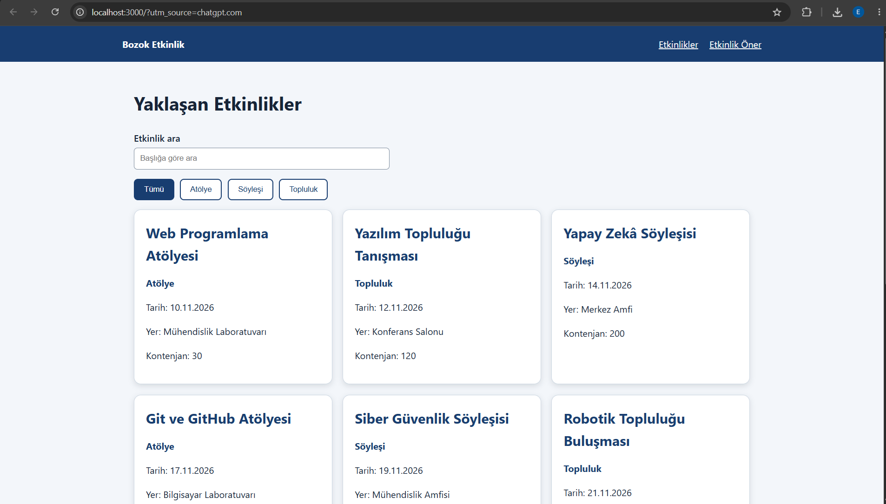

# Kampüs Etkinlik Panosu

BMH231 Web Programlama Ödev 2 kapsamında geliştirilen, kampüs etkinliklerini listeleyen ve etkinlik önerisi alınmasını sağlayan web uygulamasıdır.

## Kullanılan Teknolojiler

- HTML5 (Semantik HTML)
- CSS3 (Grid, Flexbox, Responsive Tasarım)
- JavaScript (DOM, Fetch API, Async/Await)
- Node.js (http, fs, path modülleri)
- Git ve GitHub

## Proje Özellikleri

- Kampüs etkinliklerini listeleme
- Etkinlik başlığına göre arama
- Etkinlik türüne göre filtreleme
- Mobil cihazlara uyumlu tasarım
- Etkinlik öneri formu
- Form doğrulama ve kullanıcıya geri bildirim
- API üzerinden etkinlik verilerini görüntüleme
- API bağlantı hatalarında kullanıcıyı bilgilendirme
- Klavye ile erişilebilir filtre butonları

## Uygulamanın Kullanımı

### Etkinlikleri Görüntüleme

Ana sayfa açıldığında kampüs etkinlikleri API üzerinden alınarak kartlar halinde listelenir. Her kartta etkinliğin başlığı, türü, tarihi, yeri ve kontenjan bilgisi bulunur.

### Etkinlik Arama

"Etkinlik ara" kutusuna bir etkinlik başlığı yazıldığında sonuçlar otomatik olarak filtrelenir. Arama büyük ve küçük harf ayrımı yapılmadan gerçekleştirilir.

### Tür Filtreleme

Tümü, Atölye, Söyleşi ve Topluluk düğmeleri kullanılarak etkinlikler türlerine göre görüntülenebilir.

Arama ve tür filtresi birlikte çalışır. Seçilen koşullara uygun etkinlik bulunmadığında kullanıcıya bilgilendirme mesajı gösterilir.

### Etkinlik Önerme

Sayfanın altındaki "Etkinlik Öner" formuna etkinlik adı, tarih ve e-posta adresi girilebilir.

Form gönderildiğinde aşağıdaki kontroller gerçekleştirilir:

- Etkinlik adı en az 5 karakter olmalıdır.
- Etkinlik tarihi boş veya geçmiş bir tarih olamaz.
- E-posta adresi geçerli biçimde olmalıdır.
- Hatalı girişlerde kullanıcıya hata mesajı gösterilir.
- Geçerli girişlerde teşekkür mesajı gösterilir.

Form, önerileri sunucuya kaydetmez. Yalnızca istemci tarafında doğrulama ve geri bildirim sağlar.

## Kurulum ve Çalıştırma

Bilgisayarda Node.js ve Git kurulu olmalıdır.

Projeyi indirmek ve çalıştırmak için:

```bash
git clone https://github.com/esra-yldrm-svg/bmh231-odev2.git
cd bmh231-odev2
npm start
```

Tarayıcıdan http://localhost:3000 adresini açın.

## API Uç Noktaları

| Yöntem | Yol | Açıklama |
|---|---|---|
| GET | / | Ana sayfa |
| GET | /api/etkinlikler | Tüm etkinlikleri listeler |
| GET | /api/etkinlikler?tur=atolye | Atölye türündeki etkinlikleri listeler |
| GET | /api/etkinlikler/2 | ID değeri 2 olan etkinliği getirir |
| GET | /api/etkinlikler/999 | Etkinlik yoksa 404 döndürür |
| DELETE | /api/etkinlikler/2 | İzin verilmeyen yöntem için 405 döndürür |

## API Test Komutları

PowerShell terminalinde aşağıdaki komutlar kullanılabilir:

```powershell
curl.exe -i "http://localhost:3000/api/etkinlikler?tur=atolye"
curl.exe -i http://localhost:3000/api/etkinlikler/2
curl.exe -i http://localhost:3000/api/etkinlikler/999
curl.exe -i -X DELETE http://localhost:3000/api/etkinlikler/2
```

## Testler

- Masaüstü ve mobil görünüm kontrolü
- Lighthouse erişilebilirlik testi
- API GET isteklerinin kontrolü
- Geçersiz etkinlik ID'sinde 404 yanıtı
- Desteklenmeyen HTTP yönteminde 405 yanıtı
- Geçerli ve geçersiz e-posta ile form doğrulama
- API bağlantı hatasının kontrolü
- Network panelinden ağ performansının incelenmesi

## Proje Dosyaları

- `public/index.html`: Sayfanın HTML yapısı
- `public/stil.css`: Tasarım ve mobil uyumluluk
- `public/betik.js`: Etkinlik listeleme, filtreleme ve form kontrolleri
- `sunucu.js`: Node.js HTTP sunucusu ve API
- `etkinlikler.json`: Etkinlik verileri
- `package.json`: Proje çalıştırma ayarları
- `.gitignore`: Git tarafından izlenmeyecek dosyalar
- `README.md`: Proje açıklamaları ve kullanım bilgileri

## Proje Ekran Görüntüsü

Kampüs Etkinlik Panosu uygulamasının masaüstü görünümü aşağıda yer almaktadır.



## Geliştirici

**Ad Soyad:** Esra Yıldırım

**Öğrenci Numarası:** 16008125057

**Üniversite:** Yozgat Bozok Üniversitesi

**Bölüm:** Bilgisayar Mühendisliği

**Ders:** BMH231 Web Programlama

**Ödev:** Ödev 2 - Kampüs Etkinlik Panosu

**GitHub:** https://github.com/esra-yldrm-svg/bmh231-odev2
